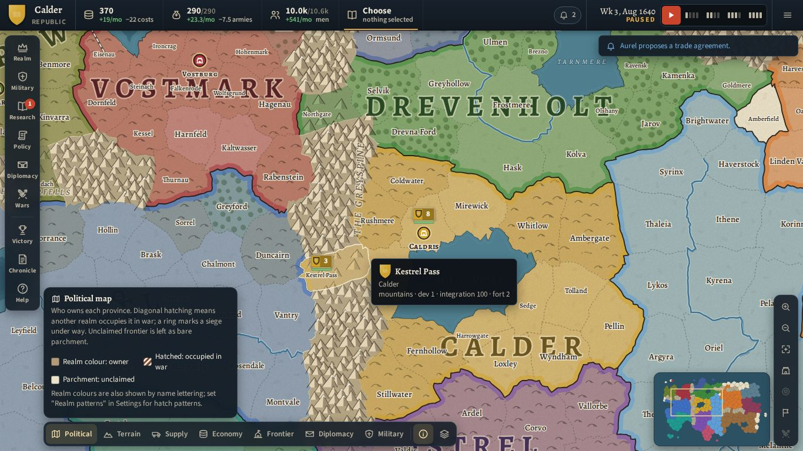

# Crown & Frontier

A single-player grand strategy game for the browser. You rule a young crown at the dawn of the
industrial age, on one of eleven maps or one you make yourself. Grow by
settlement, investment or conquest, but every province you gain
beyond your heartland is **raw frontier**: it pays little, raises no troops and supplies no
armies until you integrate it. Outlast your AI rivals and win by territorial dominance,
economic prosperity or diplomatic leadership.



- **Eleven maps.**
  - *Aldmere*, the standard campaign: 298 provinces, 14 realms, four mountain ranges with
    six passes, six rivers, 34 unclaimed frontier provinces and 30 sea zones.
  - *The Reach*, the quick campaign: 99 provinces and 9 realms.
  - Three generated maps: *the Sundered Isles* (116 provinces, a naval war among islands),
    *the Kharan Steppe* (263, a war of movement) and *the Middle Sea* (548 provinces and 16
    realms around an inland sea).
  - *Hesperia, 1890*, a large original world from authored geography: 754 provinces and 22
    realms on two continents facing each other across the Narrows, with three unclaimed
    frontiers.
  - Five historical maps built from Natural Earth (public domain), with the borders of the
    time approximated from present-day divisions; Europe and the World start with the
    treaties and claims of their year:
    - *The Baltic, 1906*: Sweden, Norway, Denmark, the German Empire and the Russian Empire.
    - *Europe, 1914*: 686 provinces and 23 realms, from Ireland to the Volga.
    - *The World, 1914*: 1,225 provinces and 57 realms, colonial empires on every continent.
    - *Europe, 1936*: 689 provinces and 32 realms on 1 January 1936: the successor states of
      1918, the Soviet Union, a rearming Germany ringed by French alliances.
    - *The World, 1936*: 1,231 provinces and 69 realms: the League mandates, Manchukuo,
      Saudi Arabia, Italy at war in Ethiopia.
- **Map library and editor.** Keep your own maps in the browser. Generate a new map from a
  seed, size, number of realms, shape and climate, then edit it by hand. Paint realms,
  regions, terrain and deposits; edit straits, rivers, ports, capitals, claims and the
  treaties in force at the start; merge provinces. A validator outlines every error on the
  map and takes you to it. Export and import map files (an unfinished map reopens in the
  editor to be finished), and play any map.
- **An ivory atlas in slate furniture.** The map is ivory land and blue-grey water, with
  muted realm washes, inked borders, terrain motifs, counters, and landmarks at local zoom.
  One collision registry places every name and marker. Ledgers are opaque ivory registers in
  slate frames. Detail changes with zoom, and nine map modes (political, terrain, supply,
  economy, frontier, diplomacy, military, resources, sea control) each come with a legend.
- **Systems:** an industrial economy with six resources (food, coal, iron, oil, rubber,
  nitrates), factories and materiel. **Trade contracts** set a good, a quantity, a price and a
  term; stock is reserved and delivered overland or by sea, blockades hold it back, and
  defaults and cancellations have costs. Forecasts show each good six months ahead;
  population and manpower; supply lines; an industrial-age roster (infantry, cavalry,
  artillery, engineers, armour) in battles shaped by terrain, rivers, forts and trenches.
  Every army says why an order is stalled and what helps or hurts it where it stands;
  sieges; **navies** (transports, torpedo boats, cruisers, battleships, submarines,
  carriers) that fight for sea zones, close straits, blockade coasts and carry armies to
  hostile shores, where a coast held with a fleet offshore becomes a beachhead that supplies
  them, raid the trade on sea routes and shell battles on the coast; **air wings**
  (reconnaissance, fighters, ground attack, bombers) flying from airfields or carriers, within a
  range counted over land and sea and with readiness to manage, for air superiority, ground
  support committed to one battle, interdiction, bombing and naval strikes; wars on realms we
  do not border, with an assessment of whether we can reach them first; a five-era
  research tree of 73 technologies in five branches with horizon years; **national focus
  trees** (a generic tree and a national branch for every realm); diplomacy with coalitions,
  **guarantees, influence and spheres, loans and trade blocs**; **peace settlements** with
  several parties and graded demands, shared by each winner's contribution, with
  counter-offers; 20 events; and three victory paths.
- **AI rivals:** five temperaments and three difficulty levels, using exactly the same rules
  and commands as you.
- **Help and saving:** a 15-step tutorial that you complete by doing each thing (the capital,
  a project, industry and resources, a regiment, a march, supply and the frontier, sea and
  air, diplomacy, a national focus, how wars end, victory), rich tooltips, visible reasons for
  every unavailable action, battle forecasts, army groups and standing orders, autosave, and
  save export/import. The game pauses for wars, events, proposals and a finished technology
  or focus (each can be turned off). Works with mouse, keyboard and touch.
- **No installation, account or server:** static HTML5 files; everything runs in your browser.

## Play

Open the hosted build in any current browser. Once GitHub Pages is enabled for this
repository (see [DEPLOYMENT.md](DEPLOYMENT.md)) it is served at
`https://<owner>.github.io/crown-and-frontier/`; no live URL has been published yet.
Any static web host works: upload the contents of the release ZIP.

The game must be served over `http(s)://`. Opening `index.html` directly from disk
(`file://`) does not work, because browsers block module scripts there; the page explains
this if you try.

### Controls

| Action | Mouse / keyboard | Touch |
|---|---|---|
| Select a province, army, fleet or sea zone | Click | Tap |
| Move the selected army | Right-click a province, or **G** / Move then click | Long-press a province, or "March here" in the province card |
| Sail the selected fleet | Right-click a sea zone or coast, or **G** / Sail then click | "Sail" in the fleet card, then tap |
| Carry an army by sea | "Ship by sea" in the army card (a fleet with transports off its coast), then click the beach | the same, with taps |
| Air missions | Select a wing (in its airfield's province card, its carrier's fleet card or the Military ledger), choose a mission, click the target province or sea zone (the shading is its range; the hover says whether it can fly there); **Esc** cancels | the same, with taps |
| Add a waypoint | **Shift**+right-click | — |
| Pan / zoom | Drag / mouse wheel, arrow keys, **+ / −** | Drag / pinch |
| Pause, speed | **Space**, **1–4** | ▶ and speed pips |
| Ledgers | **B** realm, **I** industry, **M** military, **T** research, **P** national focus, **D** diplomacy, **W** wars, **V** victory, **L** chronicle, **H** help | Bottom bar |
| Map modes | **Shift+1…9**, **O** cycles | Mode bar |
| Navigate | **F** whole map, **C** centre selection, **Home** capital, **N** next army, **Shift+N** next army group, **K** next battle, **J** latest alert | Navigation buttons |
| Close | **Esc** cancels, closes, then opens the menu | ✕ buttons |

### Saves

- **Autosave** runs every few in-game months (see Settings) and whenever the tab is hidden or closed.
  It alternates between two slots, so an interrupted write never destroys the only copy.
- **Manual saves** go to three slots via ☰ Menu.
- **Export and import** write and read a `.json` file, so a campaign can move between browsers, devices or sites.
- **Where saves live:** in this browser only (IndexedDB, falling back to localStorage or, if storage is
  blocked, memory for the session). They do **not** sync between devices or websites, and private
  browsing or managed-device (school) policies may erase them. Export anything you care about.
- **Damaged files:** truncated, modified or foreign save files are rejected with an explanation, and
  your current campaign is kept.
- **Each save keeps its map.** A save records exactly which map and map revision it was played
  on. Saves of imported maps carry the map with them.
- **Saving into a used slot keeps the save it replaces,** listed as "Slot N (the save it
  replaced)" on the Load screen.
- **Older saves are converted, never discarded.** Saves from earlier releases (formats 1–4)
  are converted to the current format (5, trade contracts) when loaded, and the game says
  what changed. A save that cannot be converted stays in the list with the reason and can
  still be exported.

## Develop

Requires Node.js 22 and npm.

```bash
npm ci                 # install exact dependency versions from package-lock.json
npm run dev            # dev server at http://localhost:5173
npm test               # rule, persistence, determinism and AI tests (Vitest)
npm run build          # type-check + production build into dist/
npm run package        # release/crown-and-frontier-web.zip (index.html at the root) + .sha256
npm run verify:web     # browser checks (root, subpath, ZIP, iframe, touch, saves, storage, performance)
npm run sim -- --scenario aldmere --seeds 1-10 --difficulty all --years 60 --out reports/ai-campaigns-aldmere.md
npm run sim -- --scenario reach --seeds 1-10 --difficulty all --years 40 --out reports/ai-campaigns.md
npm run examples       # worked combat examples from the real combat code
npm run genworld       # regenerate Aldmere from tools/aldmere.spec.ts (deterministic)
npm run genmap         # regenerate the Reach's geometry (byte-identical to the checked-in file)
npm run genmaps        # regenerate the Isles, the Steppe and the Middle Sea from their recipes
npm run genbaltic      # rebuild The Baltic, 1906 from Natural Earth (downloads and checks the data)
npm run genreal -- --map europe   # rebuild Europe, 1914 (or earth, europe-1936, earth-1936, hesperia) through tools/realmap.ts
npm run atlas:assets   # bring the atlas pack's art and fonts in from the committed handoff zip
npm run check          # typecheck + tests + build + package + verify:web
npm run fuzz -- --scenario aldmere --seeds 1-3 --years 8   # random legal/illegal commands + invariants
npm run bench -- --scenario aldmere --seeds 1-2 --years 30 # simulation benchmarks (tick percentiles, phases, heap)
npm run bench:web -- --maps reach,aldmere                   # browser benchmarks on dist/ (after npm run build)
npm run bench:web -- --maps earth --stress earth:1:280      # adds a late-game run on the World
npx tsx tools/shots-atlas.ts after                          # the screen inventory in screenshots (after npm run build)
npm run rulecheck -- --compare <record.json>                # prove a refactor changed no rule
npm run genstress -- --provinces 900                        # generated large map package for scaling tests
```

`verify:web` needs Chromium for Playwright. Run `npx playwright install chromium` once, unless your
environment already provides it.

### Project layout

```
src/sim/        headless simulation — no DOM; runs in tests and CLI tools
  types.ts      state and command types        config.ts   every tunable number
  commands.ts   the single validation boundary for player AND AI actions
  tick.ts       fixed weekly tick order        game.ts     new-game setup
  index.ts      derived lookups (armies by province, provinces by owner, relations)
  economy, construction, integration, military, movement, supply, combat, siege,
  naval (fleets, sea control, landings), air (airfields, wings, missions),
  war, settlement (peace settlements), diplomacy, influence (spheres, guarantees,
  loans, trade blocs), progression, focus (national focus), events, victory, invariants,
  save, migrate (save formats), diagnostics + replay (bug reports)
src/maps/       map package format (v3: sea zones and ports), validator (imports are
                sanitised and size-limited), sea-zone generation, built-in maps as packages,
                conversion to the simulation and renderer, editing operations (edit.ts)
  gen/          world generator, procedural maps, names, shared Voronoi core
  ai/           strategic, operational/execution layers, navy and air, difficulty profiles
  data/         technologies, focus trees, personalities, events
src/data/       built-in map data: Aldmere and the Reach (realms and regions in aldmere.ts and
                reach.ts, generated province data and geometry), and maps/ (the generated maps,
                Hesperia and the real-world maps); geometry is loaded on demand
src/assets/     the atlas pack's art (atlas/) and fonts, imported through Vite
src/ui/         map renderer (map/), design system (style.css), HUD, inspector, ledgers,
                dialogs, screens, map library (library.ts, maplib.ts), map editor (editor/),
                tutorial, storage, audio
tools/          map generators (genworld, genmap, genmaps, genbaltic; realmap + genreal with the
                *.data.ts definitions for Europe, the World and Hesperia), AI campaign runner, realm tracer,
                ZIP packager, web verifier, combat examples, benchmarks, fuzzer, rule check
tests/          Vitest suites
e2e/            scripted browser playthrough (development helper)
reports/        generated evidence: AI campaign statistics, web verification, perf/ benchmarks
```

**Reporting bugs:** Chronicle ledger (**L**) → *Export bug report*. The file contains the settings,
the starting point (a fresh game, or the save the campaign was loaded from), your commands since
then, recent notifications and AI diagnostics. `npx tsx tools/replay.ts <file>` replays it and checks
that the final state matches.

## Documentation

- [DESIGN.md](DESIGN.md): the implemented rules, formulas, worked examples, AI and balance evidence.
- [DEPLOYMENT.md](DEPLOYMENT.md): GitHub Pages, other hosts, the ZIP, embedding, and browser compatibility.
- [STATUS.md](STATUS.md): the requirement ledger, acceptance checks, known limitations and next steps.
- [docs/REDESIGN.md](docs/REDESIGN.md): the interface and world redesign: diagnosis, direction and what was built.
- [docs/atlas/](docs/atlas/): the atlas and strategy refinement update:
  - [AUDIT.md](docs/atlas/AUDIT.md): the audit, baseline and plan;
  - [SCREENS.md](docs/atlas/SCREENS.md): the screen inventory with patterns, states and
    verified interactions;
  - [MAPS.md](docs/atlas/MAPS.md): the shared map format, the pipeline, how to author a map,
    the new maps' targets and counts, and their performance;
  - [SESSIONS.md](docs/atlas/SESSIONS.md): the recorded player-style sessions on Europe and
    the World, what they found and what was fixed.
- [docs/expansion/](docs/expansion/): the strategic depth expansion, with the Stage A audit
  ([AUDIT.md](docs/expansion/AUDIT.md)), the plan and requirement ledger
  ([PLAN.md](docs/expansion/PLAN.md)), the setting decision ([SETTING.md](docs/expansion/SETTING.md))
  and the recorded player-style session ([SESSIONS.md](docs/expansion/SESSIONS.md)).
- [THIRD_PARTY_NOTICES.md](THIRD_PARTY_NOTICES.md):
  - the two bundled OFL fonts and the atlas art, including four AI-generated landmark
    illustrations;
  - the geometry libraries of the map generator (d3-delaunay, delaunator,
    robust-predicates), whose licences ship in `licenses/`;
  - Natural Earth (public domain) for the three real-world maps;
  - the development tools.

## Known limitations

- **Balance:** tuned against AI-only campaigns, 16 per map (`reports/stage-e/`,
  `reports/stage-f/`). Half or fewer end on score at the limit on every map, but wins
  concentrate on some: Astia and Gorathia share the Kharan Steppe, Ostmark wins 9 of 16 on
  the Sundered Isles, and the richest heartlands still lead on Aldmere and the Reach.
  Diplomatic Leadership is the most common win on the Reach, the Middle Sea and the Baltic.
  Hrafnmark and some other small or exposed realms shrink on average. No external players
  have tested the game; the one recorded session is the author's
  (`docs/expansion/SESSIONS.md`).
- **AI wars across the water:** you can fabricate a claim on a coast within one sea zone of
  your ports, but AI realms plan wars only against realms they border by land or strait, so
  island AIs seldom start wars.
- **Crowns pile up** in a small realm late in a campaign: construction slots, slipways and
  manpower limit spending, and there is no late-game sink yet.
- **Fog of war:** not implemented. All information is public to everyone, AI included.
- **Browsers verified:** only headless Chromium 141, on desktop and emulated phone viewports. Firefox,
  Safari, real Chromebooks and real touch devices are untested.
- **Not in the game:** multiplayer, espionage and dynasties are out of scope. The tutorial
  introduces settlements and influence in a sentence each; the Help ledger explains them.
- **Map editor:** it cannot split a province, draw coastline by hand or reshape sea zones;
  generate a new map for a different coast. Maps made in the editor are kept only in this
  browser until exported.
- **The Baltic, 1906:** some borders of 1906 are approximated from present-day divisions
  (see `tools/baltic.data.ts`), and present-day populations stand in for those of 1906. The
  empires start far larger than the kingdoms. In 16 AI campaigns Russia won 6 on score and
  Sweden and Denmark 10 by diplomacy; Norway and Denmark rarely fight.
- **Navy and air are abstracted:** fleets fight in sea zones and wings fly missions over a
  province and its neighbours, or over one sea zone; there are no individual ships' positions
  or air routes, and convoys are the trade on a route between two ports, raided zone by zone.
  Troops at sea cannot be redirected until they land.
- **Save format:** 6.
  - Format-1 to format-5 saves are converted on load, each with a notice.
  - A format-5 campaign keeps its wings' missions (fully ready, at their airfields); its
    carriers start with empty decks.
  - A format-4 campaign keeps its running trade exchanges as 12-month contracts at list price.
  - A format-3 campaign keeps each realm's national policy as the matching completed focus.
  - Format-3 saves written before Stage C load with empty navies and air arms.
- **The World maps at the fastest speed:** in a world war (week 280) the World, 1914 gives
  5.8 of the 6 weeks a second and the World, 1936 (69 realms) 4.6, in headless Chromium with
  software rendering on a 4-core machine; the map and controls keep responding (frame p95
  33 ms). One AI realm's planning can still take about 40 ms in a single slice. Measurements
  are in `reports/perf/lag-diagnosis.md` and `docs/atlas/MAPS.md`.
- **The 1936 maps start late in the research tree:** a 1936 start knows every technology
  up to 1931, so six remain to research; there are no technologies, units or rules beyond
  1936 (no Second World War mechanics).
- **The historical maps end on score:** in AI-only campaigns no realm completes a
  victory within 30 years, and the largest starting realm (Britain on the World, Russia
  on Europe) leads on score (`reports/ai/`).
- **Historical maps are approximations:** the borders of 1906 and 1914 follow present-day
  divisions where they differ, and starting forces and AI temperaments are game choices
  (`docs/atlas/MAPS.md`).

## Licence

This repository does not yet include a source licence. The owner decides the licence and whether the
repository is public. All game content (names, maps, rules and text) is original, except the
geography and place names of the three real-world maps (The Baltic, 1906; Europe, 1914; The World,
1914), which come from Natural Earth (public domain), and the atlas art described in
THIRD_PARTY_NOTICES.md. See that file for the bundled fonts and libraries, the map data and the
development tools.
